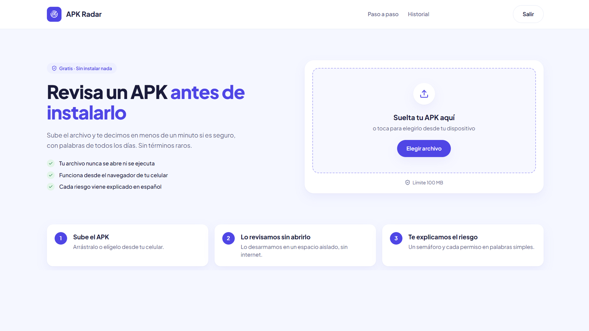

# APK Radar · Base de datos (`fakeapp-radar-db`)

Todo lo de base de datos de FakeApp Radar: contenedor de PostgreSQL, tablas (migraciones con Alembic) y datos iniciales (catálogo de permisos). La API solo se conecta; no define tablas.

Proyecto final de Seguridad Informática · Universidad Politécnica de Chiapas. Repos relacionados: [API](https://github.com/Miteek2000/fakeapp-radar-api) y [Frontend](https://github.com/Miteek2000/fakeapp-radar-web).

## Levantar (siempre ESTE repo primero, luego la API)
1. Copia `.env.example` a `.env` y pon una contraseña real.
2. `docker compose up -d --build`
3. Revisa con `docker compose ps -a`: `fakeapp-db` debe decir **healthy** y `migrate` debe quedar en **Exited (0)** (aplicó las tablas y cargó el catálogo y se apagó; es lo correcto).
4. Mira lo que hizo: `docker compose logs migrate`

Los dos servicios comparten con la API la red Docker `fakeapp-net` (la crea este compose).

## Red
`fakeapp-net` es una red **interna** (sin salida a internet) compartida con la API. Si la creaste antes de la fase 6 y Docker se queja de que cambió, baja ambos repos con `docker compose down` (sin `-v`, así no se borran los datos) y vuelve a levantarlos: primero este.

## Estructura
| Carpeta | Qué tiene |
|---|---|
| `migrator/` | Alembic: `migrations/versions/` (una migración por cambio de tablas), `seed.py` y su Dockerfile |
| `seeds/` | SQL con datos iniciales (se pueden repetir sin duplicar) |
| `init/` | Se ejecuta solo al crear el volumen por primera vez (extensiones) |
| `docs/Esquema_Base_de_Datos.docx` | Descripción de las tablas y columnas |

## Cambiar las tablas
1. Crea un archivo nuevo en `migrator/migrations/versions/` (0003, 0004...) con `upgrade()` y `downgrade()`.
2. `docker compose up -d --build migrate` aplica lo nuevo.
3. Actualiza el modelo en la API (`app/models.py`) y `docs/Esquema_Base_de_Datos.docx`.

## Notas
- Solo escucha en 127.0.0.1:5433 (tu computadora), no en la red. Sirve para DBeaver o psql.
- `docker compose down -v` borra los datos. Sin `-v` se conservan.

## Licencia
MIT. Ver [LICENSE](LICENSE).
