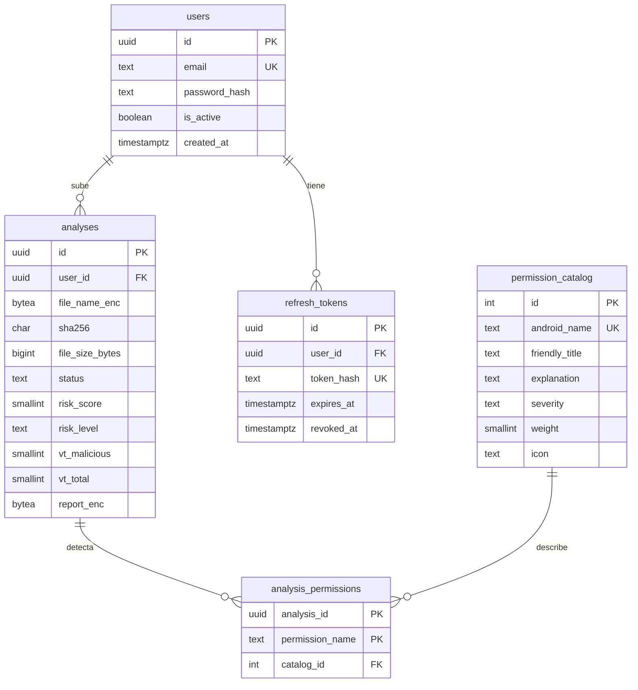

# Esquema de la base de datos

Las tablas las crean las migraciones de este repo (`migrator/migrations/versions/`). Este documento es la referencia del diseño.

Estado: ya existen `analyses` (0001) y `permission_catalog` (0002). Las demás llegan en fases siguientes.

## Tablas

| Tabla | Para qué sirve |
|---|---|
| `users` | Cuentas. Solo se guarda el hash de la contraseña (nunca la contraseña). |
| `refresh_tokens` | Tokens de refresco del login. Se guarda su hash, no el token. |
| `analyses` | Un registro por APK analizado: estado, puntaje, resultado de VirusTotal y reporte. |
| `permission_catalog` | Permisos de Android que sabemos explicar: nombre, traducción a español, severidad y peso. |
| `analysis_permissions` | Qué permisos trae cada APK. `catalog_id` queda vacío si el permiso no está en el catálogo. |

## Reglas de diseño

- **Cifrado en reposo (AES-256-GCM):** `file_name_enc` y `report_enc` guardan `nonce + texto cifrado + etiqueta`. El cifrado y la llave viven en la API; la base de datos nunca ve el contenido ni la llave.
- **El hash SHA-256 va sin cifrar** para poder buscar y consultar VirusTotal. Un hash no revela el contenido del archivo.
- `status`: `pending`, `running`, `done` o `failed`.
- `severity` (del catálogo): `peligroso`, `atencion` o `normal`.
- `risk_score` va de 0 a 100. Niveles propuestos (ajustables): `bajo` 0-29, `medio` 30-59, `alto` 60-100.
- Los pesos del catálogo son una propuesta inicial; se calibran con APKs de prueba.